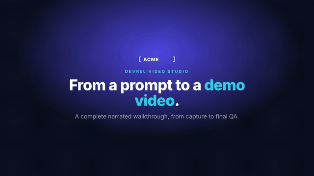

# Narrated terminal/browser demo

[](https://raw.githubusercontent.com/aaitor/skill-video-studio/a926d97b19a8453a3a88fe37fe00734773f657f4/assets/default-demo.mp4)

**[Download the full video with sound](https://raw.githubusercontent.com/aaitor/skill-video-studio/a926d97b19a8453a3a88fe37fe00734773f657f4/assets/default-demo.mp4)** (32.1 seconds, 1920 × 1080, H.264/AAC). This is the default README video. The previous fixed-duration cut has been replaced.

A single local **Kokoro `af_heart`** narrator guides the complete flow: terminal prompt → real Acme browser capture → analytics filter → Usage Insights detail → terminal result → closing card. Scenes fade through the brand background at both environment changes. Music stays quiet under the narration, and EN/ES caption sidecars accompany the sources.

The terminal scenes are **authored HTML reenactments**, not footage of a live Claude Code run. The browser footage records real interactions with the bundled Acme fixture. The finished MP4 was actually rendered and checked; the separate [live intake demo](../../examples/README.md) records real Claude Code planning and stops before rendering.

## Rebuild

Requires the [capture/render prerequisites](../../docs/installation.md#capture-and-rendering-prerequisites), HyperFrames CLI (the checked render used 0.9.5), and the development Python dependencies. Install the optional local voice runtime into your virtual environment:

```bash
python3 -m pip install kokoro-onnx==0.6.1 soundfile==0.14.0
export HYPERFRAMES_PYTHON="$(command -v python3)"
# The first local TTS run downloads Kokoro's model and voices. No TTS account is required.
```

From the repository root, serve the fixture in a separate terminal:

```bash
python3 -m http.server 8000 --bind 127.0.0.1 --directory projects/example-walkthrough/site
```

Then capture, generate narration, and render:

```bash
S=.claude/skills/devrel-video
$S/scripts/capture.sh projects/example-cli-tour/capture.js http://127.0.0.1:8000/
projects/example-cli-tour/narrate.sh
$S/scripts/render-qa.sh projects/example-cli-tour
$S/scripts/thumbnail.sh projects/example-cli-tour
python3 scripts/check_demo_audio.py projects/example-cli-tour/renders/out.mp4 projects/example-cli-tour/narration-mix.mp3
```

Stop the fixture server when finished. `narrate.sh` uses `af_heart` for every sentence. To select another local Kokoro voice, pass its ID; to use your configured Orpheus endpoint, run `NARRATION_ENGINE=orpheus projects/example-cli-tour/narrate.sh dan`.

## Why the voice stays complete

The old mixer placed lines on fixed beats, added overlapping takes, and clipped samples at 27.2 seconds. The replacement measures every WAV and places each sentence sequentially, with a 300 ms gap and an 800 ms final tail. It never truncates or accelerates speech. Those measurements update the composition, browser action segments, captions, total duration, and music bed together.

`narrate.py` writes `voice.wav`, `timing.json`, `capture-timed.mp4`, and the updated composition/captions. `narrate.sh` generates the local voice takes and mixes the quiet music bed at −16 LUFS. GitHub strips custom video tags from repository READMEs, so the README uses an animated preview linked directly to the immutable reviewed MP4. The hosted file was tested in Chrome for loading and playback. When replacing this video, update both the tracked MP4 and the pinned download URL. Browser timing uses the capture script's 7.8-second filter and 14.1-second detail boundaries; update those boundaries if you change the capture flow.

`python3 scripts/check.py` includes an offline regression with a 37-second voice track whose last sentence exceeds the old closing slot. It verifies every spoken sample, both channels, the final tail, and repeatable scene retiming. Live TTS and renders stay outside CI.

## Checked deliverables

- [Public README MP4](../../assets/default-demo.mp4), [preview](renders/demo.gif), [thumbnail](renders/thumbnail.jpg), and [contact sheet](renders/contact-sample.png).
- [English captions](captions.en.srt) and [Spanish captions](captions.es.srt).
- HyperFrames lint: zero errors; runtime/layout/motion/audio checks pass; all sampled text passes WCAG AA contrast. Structural/style advisories remain nonblocking.
- Final MP4 audio is compared with the complete reference mix in half-second windows to detect missing audio, level changes, or cuts introduced by rendering/encoding. See [QA record](qa.md).

`assets/default-demo.mp4` is the one explicitly tracked public video. Intermediate captures, voice takes, mixes, and other rendered MP4s stay ignored. No presenter footage, credentials, or host configuration is included.
